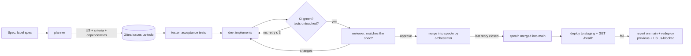

# AGENT.md

## Goal

A local, **autonomous** software forge: I write a spec, headless Claude Code agents (`claude -p`) break it down, code it, test it and review it; the forge merges and deploys without human intervention. Every step is traced as a comment in Gitea. Personal use, one machine, Docker Compose, one forge for many projects.

**Guiding principle: agents produce, deterministic rules decide.** No agent decides on its own to merge or deploy: green CI + reviewer approval → merge; failed health check → automatic revert.

## Architecture

- **gitea** — forge, work queue and source of truth (issues, labels, PRs, history). Ports 3000 (web), 2222 (SSH).
- **act_runner** — Gitea Actions: CI (tests) only, without the Docker socket. Deterministic, no LLM.
- **orchestrator** — Go, standard library only (Gitea and Docker Engine APIs over plain HTTP), port 8000. The only process that changes labels. Dispatches tasks to agents, applies merge rules, manages retries and budgets, deploys to staging and reverts.
- **agent** — one-shot container (Node 26 + `@anthropic-ai/claude-code` + git), one role per run: `planner`, `tester`, `dev`, `reviewer`, `retester`, `integrator`.
- **staging** — one container per project, `forge-staging-<owner>-<repo>`, built from its `Dockerfile` each time a spec reaches `main`, on `localhost:<9000 + repo id>` (the app listens on 8080 inside).
- **projects** — every repository tagged with the `forge` topic that the orchestrator's token sees, discovered on each poll (`./new-project.sh` creates one). Agent slots (`MAX_AGENTS`) are shared by all projects; merges are serialized per project.



## Agent roles

| Role | Input | Output |
|---|---|---|
| `planner` | `spec` issue | child US issues: verifiable acceptance criteria, `Depends on #N`, link to the spec |
| `tester` | US | branch `agent/us-{n}` with acceptance tests in `tests/acceptance/us-{n}/` (failing), plus updates to earlier stories' tests this story supersedes |
| `retester` | US, once, when the dev ends with a `TEST CONFLICT:` line | revised tests under `tests/acceptance/` (or none, with its reasons), which the dev must then pass |
| `dev` | US + branch | code that makes the tests pass; **forbidden to modify `tests/acceptance/`** |
| `reviewer` | spec + US + PR diff | verdict `approve` / `changes` + comment; checks every acceptance criterion |
| `integrator` | spec + what stops it reaching `main` (red full suite, conflict) | fixes on `agent/spec-{n}`, up to 3 runs; **forbidden to modify `tests/acceptance/`**; never merges |

## Lifecycle

Labels: `spec`, `us-todo`, `us-in-progress`, `us-review`, `us-blocked`. "Done" = issue closed (the PR contains `Closes #N`).

1. **Planning**: `spec` issue opened → `planner` creates the US in `us-todo` and comments the plan on the spec.
2. **Dispatch**: the orchestrator takes the oldest `us-todo` US **whose dependencies are all closed** (those labelled `priority` first), up to `MAX_AGENTS` in parallel. The lock lives in the orchestrator's memory (the only label writer); the `us-in-progress` label is a trace, not a lock.
3. **Tests then code**: `tester` then `dev` on the same branch; the orchestrator opens the PR and sets `us-review`.
4. **CI gate** (Gitea Actions): the story's own acceptance tests and `make test` green **and** `tests/acceptance/` identical to the tester's commit.
5. **Review**: `reviewer` runs once CI is green. `changes` or red CI → rerun `dev` with the feedback in context.
6. **Merge**: green CI + `approve` → the orchestrator squash-merges the story into its spec's branch `spec/<n>`, the issue closes. A story outside any open spec merges into `main` directly and deploys like a spec.
7. **Spec delivery**: all child US closed (those added after the plan too) → the orchestrator copies `spec/<n>` to `agent/spec-<n>` and opens a pull request to `main`, where CI runs every acceptance test. If it is green and merges cleanly, the orchestrator squash-merges it. A red suite or a conflict goes to the `integrator` agent, at most 3 times, then blocks the spec. The agent fixes; the orchestrator alone merges, on green CI.
8. **Deployment**: after a merge into `main` the orchestrator builds the repo's `Dockerfile` and replaces the staging container; `GET /health` must answer 200 within a minute. Failure → revert the merge on `main`, redeploy the previous version, reopen the US or spec as `us-blocked`.
9. **Spec closure**: delivered and deployed → summary comment (total cost), close the spec, delete its branch.

## Autonomy safeguards

- **Retries**: at most 3 dev cycles per US, then `us-blocked` + a comment explaining the failure. `us-blocked` is the **only** point of human intervention.
- **Budget**: cumulative cost per spec (the `total_cost_usd` field of the `result` message); exceeding `MAX_COST_PER_SPEC` (or the spec's own `<!-- forge:budget=X -->` marker, set from the UI) → the spec and its remaining US go to `us-blocked`.
- **Recovery**: on startup, the orchestrator removes the agent containers its previous run left (label `forge.agent`) and moves every `us-in-progress` US back to `us-todo` (no hourly timeout: a slow agent must not be duplicated).
- `--max-turns $MAX_TURNS` (30; the tester gets 30/45/60 for low/medium/high complexity, `maxTurns` in `orchestrator/agent_runner.go`) and a 45-minute timeout per agent run.
- **Questions**: a spec too ambiguous to plan gets questions instead of stories (`{"questions": [...]}`): the spec goes to `us-blocked` with them, the human answers in its description and sets `spec` again.
- **Guard hook**: `agents/guard.mjs`, a `PreToolUse` hook in the agent image, refuses during the run what the checks would reject after it: dev edits under `tests/acceptance/` or `PROTECTED_PATHS`, tester edits outside `tests/acceptance/`, any edit by the planner or reviewer, git push, fetch, remote, rebase, switch or amend, and any written content holding a credential (the agent's own key by value, or a known token format). It is a shortcut, not the authority: the post-run checks stay.
- **Stop check**: `agents/stop-check.sh`, a `Stop` hook, runs what CI runs (`make test`, `make build`, the acceptance `run.sh` files CI would run) and checks nothing is left uncommitted when the dev or the integrator finishes. A failure sends the dev back to work in the same session, at most twice per run; then CI and the retry feedback take over.
- **Plan checks**: besides its JSON shape and dependencies, every story needs an `Acceptance criteria:` list, or the plan is rejected.
- **Handoff**: each dev retry gets the previous run's final message, or its last steps when it was cut short, next to the feedback.

## Implementation requirements

- **Invocation**: `claude -p "$(cat /task.md)" --permission-mode bypassPermissions --output-format stream-json --max-turns "$MAX_TURNS" --verbose`. Top-level stream types: `system`, `assistant`, `user`, `result`; `tool_use` entries are content blocks inside `assistant` messages.
- **Comments**: one progress comment per agent run, **edited in place** (role, current step, tools used), then replaced by a final summary. Not one comment per step.
- **Prompts**: one file per role in `agents/prompts/{role}.md`, completed with the issue's title, body and criteria.
- **Language**: code, docstrings and issue comments in English.
- **Style**: simple, no premature abstraction, each module < 200 lines.

## Security (assumption: Gitea reachable on localhost only, single user)

- Secrets only via `.env` (gitignored): `ANTHROPIC_API_KEY` (or `CLAUDE_CODE_OAUTH_TOKEN`), `GITEA_TOKEN`, `MAX_AGENTS`, `MAX_COST_PER_SPEC`.
- Agents push via one **SSH deploy key**, shared by every project (`new-project.sh` adds `secrets/deploy_key.pub` to each repo), never via `GITEA_TOKEN`. The token stays in the orchestrator.
- `main` accepts no push at all, deploy key included: the orchestrator sets that branch protection on startup (and refuses to start without it), so only its API merges reach `main`. Each `spec/<n>` gets the same protection on creation.
- Agents hold **no** deployment secrets: deployment lives only in the orchestrator. It does not go through a CI runner: Gitea runs a pull request's own workflow files, so `.gitea/` protection blocks the merge but not the run, and a runner holding the Docker socket would hand host root to any agent-written PR.
- Known, accepted risks: the Docker socket mounted in the orchestrator = root on the host (`:ro` changes nothing); an agent in `bypassPermissions` can read its API key; an issue body is an instruction to the agent (prompt injection) — hence the localhost assumption; the shared deploy key lets an agent of one project push to any branch but `main` and `spec/*` of another (the orchestrator merges only the head it checked); `agent.sh` deletes the key file before Claude starts and only `tester`/`dev` get it back to push, but a writer agent could still read it from its parent shell's memory.

## Milestones (each must work end to end before the next)

1. **M1 — single-agent loop**: `dev` only, `MAX_AGENTS=1`, US → branch → PR. Manual merge.
2. **M2 — CI gate**: act_runner + test workflow; auto-merge when CI is green.
3. **M3 — tester + reviewer**: frozen acceptance tests, review, retries, `us-blocked`.
4. **M4 — planner**: spec → US with dependencies; spec closure; budget.
5. **M5 — parallelism**: `MAX_AGENTS > 1`, dispatch following the dependency graph.
6. **M6 — deployment**: staging deployment + health check + auto revert.

**Status: M1 to M6 generated.** All milestones done.

Decisions so far:
- Parallelism (`main.go`, `project.go`): every poll goes through the projects in name order, each filling the free `MAX_AGENTS` slots (default 1, shared by all projects), specs to plan first, then the `us-todo` US whose `Depends on #n` issues are all closed, oldest first. Each spec or US runs in its own goroutine; the in-memory `running` set is the only lock, and the next poll skips what it holds. The runner's capacity must be at least 4 × `MAX_AGENTS` (each commit runs a `test` job and 3 `acceptance` shards), or CI becomes the queue.
- Spec branches (`spec_branch.go`): so that specs built in parallel only meet once each is complete, a story of an open spec branches from and merges into `spec/<n>`, created from `main` when its first story starts. Everything `main` was to a story (tester's start, frozen and protected checks, pull request target, update before merge) is that branch now, passed around as `issue.base`. `main` only receives finished specs, squashed into one commit each, so a failed deployment's `git revert` stays a plain revert and a retry can merge the same branch again; the branch outlives the merge until the deployment passes. A spec is delivered from `agent/spec-{n}`, a fresh copy of its branch at each try, because that is where an agent may push. After the `integrator`, the checks compare trees: every file under `tests/acceptance/` or `PROTECTED_PATHS` must match its state before the run, on the spec branch or on `main`, or the spec blocks. It is not reviewed: CI on the whole suite is its gate.
- Merging (`land.go`): merges are serialized. Before merging, if the target branch moved since the branch was tested, the orchestrator merges it into the branch server side (Gitea's update-branch API) and waits for CI again; the review is not rerun, since what came in was reviewed already. For a story, a conflict, or red CI after the update, becomes feedback for the next dev attempt, which runs `git merge origin/<target>` itself. CI only ever judged a branch containing the target it merges into.
- Planning (`planner.go`, `plan.go`): the read-only `planner` ends its final message with a JSON plan. The orchestrator validates it (1 to 20 stories, unique keys, dependencies on earlier stories only) and creates the issues itself, unlabelled, each ending with `Part of #spec` and `Depends on #n` lines; the planner never gets a Gitea token. Once all exist, the spec gets a plan comment holding the story list in a hidden marker (the last marker wins) and moves `spec` → `spec-active`; only then are the stories labelled `us-todo`, so a failure never plans a spec twice (a partial plan is closed; a failed labelling blocks the spec). Invalid plan → spec `us-blocked`.
- A `spec-active` spec whose stories are all closed lands in the background, taking an agent slot while it waits for CI, then is closed with its total cost.
- Budget: each agent summary comment carries a hidden cost marker, so the spending of a spec (planner + all runs of all its stories, retries included) is read back from Gitea and survives restarts. Before starting a story, a spec over `MAX_COST_PER_SPEC` (default $20) is blocked with its waiting stories. Stories already running finish, so a spec can overshoot by up to `MAX_AGENTS` stories.
- `handle()` drives a US through the whole pipeline in one goroutine (`pipeline.go`): `tester` → up to 3 × (`dev` → checks → CI → `reviewer`) → squash merge + close. Attempts and feedback live in memory; on restart, `us-in-progress` and `us-review` US go back to `us-todo`. A US whose branch has dev work after the tester's commits resumes it, skipping the tester and keeping its tests frozen (`resume.go`); if CI had failed on that branch, `main` is merged into it first so CI runs again (Gitea never reruns an unchanged commit), and when `main` has not moved the dev gets the failure. Otherwise it starts over. Deleting the branch forces a fresh start.
- The `tester` force-pushes a fresh `agent/us-{n}` from its target branch; `dev` and `reviewer` check that branch out; only `dev` pushes after it, never forced.
- Test conflicts: a dev that ends its summary with `TEST CONFLICT: <file>: <change>` lines gets the `retester` once per story, on the same branch, before the checks. It may change only `tests/acceptance/` (guard hook and tree check), pushes without force, and its commit (author `forge-agent-retester`) becomes the tree the frozen check holds the dev to; a resume finds it again. If it keeps the tests, the dev gets its reasons as feedback. The reviewer judges its edits like the tester's.
- Deterministic checks, comparing git trees through the Gitea API (`checks.go`):
  - the tester changed only `tests/acceptance/`, and wrote something in `tests/acceptance/us-{n}/`. It may update earlier stories' tests when this story changes the behavior they pin down (otherwise merged tests could never evolve: a story adding a language broke an earlier exact-output test). Such updates are announced in a 🧪 comment, and the reviewer must reject any that the story does not require;
  - the dev changed no acceptance test: every file the tester wrote or rewrote is identical to the tester's commit, and every other file under `tests/acceptance/` matches either the tester's commit or the current `main` (a merge of `main` brings in other stories' tests);
  - nothing under `PROTECTED_PATHS` (default `.gitea/`) differs from both the original base and the current `main`;
  - CI is `success` (30 min timeout);
  - the reviewer did not push, and its final message ends with `VERDICT: approve`;
  - the merge names the checked head commit: Gitea refuses it if the branch moved since.
- A failed check, red CI or `VERDICT: changes` becomes feedback for the next `dev` attempt (env `FEEDBACK`, appended to its prompt); red CI feedback carries the end of the failed jobs' logs, read from Gitea's web log route since its 1.22 API has none. After 3 attempts, or on an infrastructure error, the US goes to `us-blocked`.
- CI (`templates/ci.yml`, protected) runs `make test`, then, in a second job from a fresh checkout so `make test` cannot rewrite them, every `tests/acceptance/*/run.sh` itself, split across 3 parallel shards that each build the app once (`make build`, `FORGE_PREBUILT=1`): the dev owns the Makefile but cannot drop the acceptance tests from CI. A story of a spec runs only its own `run.sh`, so that a regression elsewhere does not loop the story; the regression suite, every merged acceptance test, runs when the spec is delivered, and on a story going straight to `main`. The script therefore must exist (`pipeline.go`).
- Gitea's `ROOT_URL` is `http://gitea:3000` everywhere (the host tools use `localhost:3000`; a hosts entry is optional) so CI checkouts work from job containers.
- Deployment (`deploy.go`), still under the merge lock, so each merge into `main` gets its verdict before the next: if the merged `main` has a `Dockerfile`, the orchestrator downloads its archive from Gitea, builds `forge-app/<owner>/<repo>:<sha>` through the Docker API and replaces the project's staging container (network `forge`, `127.0.0.1:<9000 + repo id>`). No `Dockerfile` = nothing to deploy. If the build, the start or `GET /health` fails, a one-shot agent container with `ROLE=revert` runs plain `git revert` and pushes it to `revert/<sha>` with the deploy key (no Claude), the orchestrator opens a pull request from it and merges it without waiting for CI (retrying for 30 s while Gitea still checks the new pull request), the previous `main` is redeployed, and the US is reopened and blocked with the reason. Retrying it starts over from the reverted `main`.
- CI job containers never get the Docker socket (`docker_host: "-"`). Agents and CI use the same toolchain: CI jobs run in `forge-ci` (`ci/Dockerfile`: `node:26-bookworm` + Debian Chromium at `$CHROMIUM_PATH`, for browser tests), and the agent image is built on it.

## Files (M1 – M6)

```
.
├── AGENT.md
├── README.md                 # setup steps
├── new-project.sh            # create a project (repo, deploy key, CI, topic) and optionally open its spec
├── mirror.sh                 # push-mirror a project to GitHub, GitLab, Azure DevOps or any HTTPS git remote
├── examples/url-shortener/   # spec.md + WALKTHROUGH.md: every step of the forge on one project
├── .claude/skills/           # forge-setup, forge-spec, forge-status, forge-unblock (Claude Code skills to run the forge)
├── docker-compose.yml        # gitea, runner, orchestrator; shared network `forge`
├── runner/config.yaml        # act_runner: job network, no Docker socket in jobs
├── templates/ci.yml          # CI workflow to copy into the target repo
├── .env.example
├── .gitignore                # .env, secrets/
├── secrets/                  # deploy key, Gitea admin password; generated, never committed
├── orchestrator/
│   ├── Dockerfile            # golang:1.26-alpine build (vet + test) -> scratch
│   ├── go.mod                # no dependencies
│   ├── main.go               # discover projects (`forge` topic) every 30 s, shared MAX_AGENTS slots, /health
│   ├── project.go            # one repository: setup (labels, protect main, recovery), dispatch, handle(), block()
│   ├── pipeline.go           # tester -> dev attempts -> CI -> reviewer
│   ├── land.go               # serialized merge: bring the branch up to date with its target, CI again, merge, deploy if main
│   ├── spec_branch.go        # each spec's branch: story target, delivery to main, integrator (+ spec_branch_test.go)
│   ├── deploy.go             # staging build + run + health check, rollback via git revert (+ deploy_test.go)
│   ├── checks.go             # tree diffs and reviewer verdict (+ checks_test.go)
│   ├── planner.go            # spec planning, dependency-aware dispatch, budget, spec closure
│   ├── plan.go               # plan JSON, issue references, markers (+ plan_test.go)
│   ├── api.go                # JSON-over-HTTP client shared by Gitea and Docker, errors with a status code
│   ├── gitea.go              # issues, labels, comment edited in place
│   ├── gitea_pulls.go        # PRs, commit status, branch update, merge, close
│   ├── gitea_git.go          # default branch, branch head, recursive tree, archive
│   ├── docker.go             # Docker Engine API over the Unix socket: containers, logs, image build
│   ├── ui.go, ui.html        # forge UI on :8000: state from Gitea + live agent activity, retry/budget/spec actions (+ ui_test.go)
│   ├── agent_runner.go       # runs one role, reads stream-json (+ agent_runner_test.go)
│   └── config.go
└── agents/
    ├── Dockerfile            # forge-ci (the CI jobs' image, ci/Dockerfile) + claude-code
    ├── agent.sh              # clone, check out the US branch, run claude -p as $ROLE, push (ROLE=revert: git revert only)
    └── prompts/              # planner.md, tester.md, dev.md, reviewer.md, retester.md, integrator.md
```

## Verification

Setup and end-to-end checks for the current milestone: see `README.md`.

## Don't

- Don't start a milestone before the previous one runs end to end.
- No Kubernetes, Redis or ngrok: Gitea + the orchestrator are enough for the queue and the locks.
- No state outside Gitea, except the in-memory lock (rebuilt on startup).
- Never let an agent decide a merge or a deployment.
- Don't run `claude` in interactive mode.
