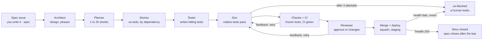

# Mustafar — Functional Guide

What the forge does and how to use it. For how it is built, see [technical-guide.md](technical-guide.md).

## What Mustafar is

Mustafar is a local, autonomous software forge: you write a spec, and headless Claude Code agents turn it into tested, reviewed, merged code running on a staging server, with no human step in between.

It runs on one machine with Docker Compose, for one user, and can host many projects at once. Every step an agent takes is traced as a comment in Gitea, so the full history of how a feature was built stays readable.

One rule holds everything together: **agents produce, deterministic rules decide.** An agent writes tests, code or a review verdict, but it never merges or deploys. The orchestrator merges only when CI is green and the reviewer approved, and it reverts automatically when a deployment fails its health check.

## Concepts

Five ideas are enough to use the forge: projects hold specs, specs split into user stories, and four agent roles move each story through labels.

| Concept | What it is |
| --- | --- |
| Project | A Gitea repository tagged with the `forge` topic. The forge discovers it automatically on its next poll. |
| Spec | An issue labelled `spec`: the feature you want, in plain words. You write it; agents never do. |
| User story (US) | A child issue the planner creates from a spec, with verifiable acceptance criteria, its dependencies (`Depends on #N`) and its complexity (`Complexity: low`, `medium` or `high`), which picks the Claude model its agents run on (set in the UI settings). |
| Agent | A one-shot Claude Code run in its own container, with one role. It starts, works on one issue, and disappears. |
| Label | The issue's place in the lifecycle. Only the orchestrator changes labels, except when you unblock something. |

The four agent roles:

| Role | Reads | Produces |
| --- | --- | --- |
| `architect` | The spec and the code | A design: how the spec fits the app (structure, data model, interfaces, decisions), phases for a big change, and the new `docs/architecture.md` that the reviewer then enforces. Or questions, like the planner |
| `planner` | The spec and the architect's design | A plan: 1 to 20 stories, with acceptance criteria and build order. Or, for a spec too ambiguous to plan, questions to answer in the spec |
| `tester` | A story | Failing acceptance tests in `tests/acceptance/us-<n>/` |
| `retester` | A story whose dev reported a `TEST CONFLICT:` (once per story) | Revised acceptance tests, or its reasons for keeping them |
| `dev` | The story and its tests | Code that makes the tests pass. It may not touch the tests. |
| `reviewer` | Spec, story and diff | A criterion → test table, then `VERDICT: approve` or `VERDICT: changes`, with notes |

The labels:

| Label | Meaning |
| --- | --- |
| `spec` | A spec waiting to be planned |
| `spec-active` | Planned; its stories are being built |
| `us-todo` | A story waiting for an agent slot and for its dependencies |
| `us-in-progress` | The tester or the dev is working on it |
| `us-review` | A pull request is open; CI and the reviewer are judging it |
| `us-blocked` | Stopped. A human must look. |
| `priority` | Added to a `us-todo` story: it takes the next free slot before older stories (the `forge-story` skill sets it) |

Done means closed: a merged pull request closes its story, and a spec closes once all its stories are closed.

## Lifecycle of a spec

A spec travels from your issue to a running staging container in eight steps; it leaves that path only when a story is blocked.

A rejection at the checks, in CI or at review sends feedback back to the dev, up to 3 attempts. A story starts only once the stories it depends on are closed, and `MAX_AGENTS` caps how many run at once across all projects.

## What you do

Your job is to write good specs and to unblock what stops; everything between those two points runs alone.

1. **Create a project.** Run `./new-project.sh NAME [SPEC_FILE]`. It creates the Gitea repository, adds the agents' deploy key and the CI workflow, then tags it `forge`. No restart is needed.
2. **Write a spec.** Open an issue labelled `spec` describing the feature: what it does, its interface, and how you would check it. With a spec file, `new-project.sh` opens it for you. The `forge-spec` skill in Claude Code can draft it with you.
3. **Or write a single story.** For a small change, open an issue labelled `us-todo` with explicit acceptance criteria. It skips planning.
4. **Follow progress in Gitea.** Each agent run shows one comment, edited live with its latest steps, then replaced by a summary with turns and cost. The spec's plan comment lists the stories in build order.
5. **Try it on staging.** Once the project has a `Dockerfile`, each merge is deployed to `http://localhost:<9000 + repo id>`; the 🚀 comment gives the URL.
6. **Check status.** The forge UI at http://localhost:8000 shows every project, spec and story, live: each story's pipeline step (Queued, Tests, Code, CI, Review, Merge, Done), its attempt and cost, what its agent is doing right now, and each spec's progress and spend against its budget. It refreshes every 5 seconds. The `forge-status` skill gives the same report in Claude Code.
7. **Act from the UI.** Its buttons retry a blocked story (resuming its branch) or retry it from scratch (branch and pull request deleted), retry a blocked spec, set one spec's budget, open a new spec, and add a story to a spec (with `priority`, ticked by default, it starts before the other queued stories). Each one asks for confirmation, since it starts paid agent runs. The UI listens on localhost only.

The comments to recognise on an issue:

| Comment | Means |
| --- | --- |
| 🤖 Agent `role` | An agent run: live progress, then its summary and cost |
| 📋 Plan | The planner's stories, in build order |
| 🔀 Pull request opened | The story's branch is under review |
| ⏸️ Claude usage limit reached | The agent hit the Claude usage limit; it runs again after the reset, without using an attempt |
| 🔁 Attempt n/3 | The previous attempt was rejected; the feedback given to the dev follows |
| 🔄 | `main` moved; the orchestrator merged it into the branch and reruns CI |
| ✅ / 🚀 | Merged, and deployed to staging |
| ⛔ Blocked | Stopped; the reason and how to resume follow |
| ♻️ | The story went back to the queue (restart or retry), or resumes its branch |

## Safeguards and unblocking

The forge stops itself rather than loop or spend without limit; `us-blocked` is the only place it asks for a human.

| Safeguard | Rule | When it trips |
| --- | --- | --- |
| Retries | 3 dev attempts per story, each with the reason for the last rejection | Story → `us-blocked` |
| Frozen tests | The dev may not change the tester's acceptance tests; it reports a test that cannot pass with a `TEST CONFLICT:` line, and the tester revises it once | Attempt rejected |
| Protected paths | No pull request may touch `PROTECTED_PATHS` (default `.gitea/`) | Attempt rejected |
| Review | Only an explicit `VERDICT: approve` counts; the reviewer may not push | Attempt rejected, or story blocked if it pushed |
| Budget | Agent cost per spec, retries included, capped by `MAX_COST_PER_SPEC` (default $20) | Spec and its waiting stories → `us-blocked` |
| Agent limits | 30 turns and 45 minutes per agent run | That run fails |
| Claude usage limit | The subscription's 5-hour or weekly limit | The agent waits for the reset and reruns; no attempt is used |
| Staging | `GET /health` must answer 200 within one minute after a merge | Merge reverted, previous version redeployed, story → `us-blocked` |
| Restart | Stories in progress or in review go back to `us-todo` | Story resumes its branch, or starts over if the dev had not started |

To resume, read the last ⛔ comment, fix the cause, then set the label back:

| Blocked | Fix first | Then set |
| --- | --- | --- |
| Story | Sharpen its acceptance criteria, or fix the infrastructure | `us-todo` (resumes its branch; delete `agent/us-<n>` to start over from the tester) |
| Spec, planning failed | Make the spec clearer or smaller (20 stories at most) | `spec` |
| Spec, over budget | Raise its budget in the forge UI (or `MAX_COST_PER_SPEC` for every spec, then restart the orchestrator) | Retry spec in the UI, or `spec-active` then `us-todo` on its blocked stories |

The forge UI has a button for each of these retries. The `forge-unblock` skill does the diagnosis with you and asks before relabelling, since a retry starts paid agent runs again.

## Limits and known risks

Mustafar assumes one user and a Gitea reachable on localhost only; outside that, its accepted risks become real ones.

- **Prompt injection.** An issue body is an instruction to an agent. Anyone who can write issues can steer agents, so keep Gitea private.
- **Agents can read their Claude credentials.** They run with `bypassPermissions` inside their container.
- **Shared deploy key.** One key serves every project. An agent could push to any branch except `main` of another project; the orchestrator only merges the commit it checked. The key is removed before Claude starts, and `planner` and `reviewer` never get it back.
- **Docker socket.** The orchestrator holds it to build and run staging, which is root on the host.
- **Budget blind spot.** A run killed by the 45-minute timeout reports no cost, so it is not counted against the spec budget. Its summary says so.
- **Restarts lose attempt counts.** Attempts and feedback live in memory: a story in flight goes back to the queue after a restart, then resumes its branch with 3 fresh attempts.
- **Staging only.** The forge deploys to a local staging container, never to production.
