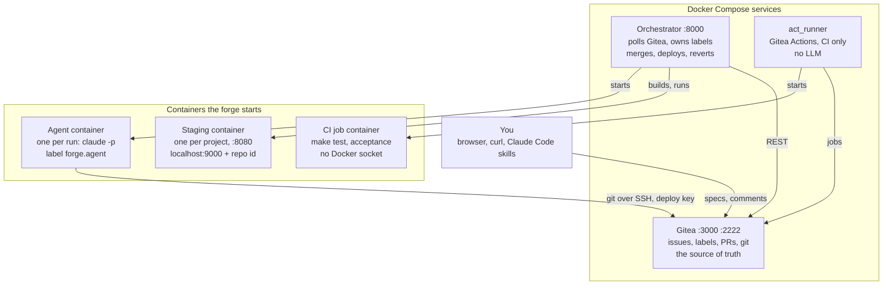

# Mustafar — Technical Guide

How the forge is built and operated. For what it does from a user's point of view, see [functional-guide.md](functional-guide.md).

## Architecture

Three Docker Compose services run permanently; the orchestrator and the runner start every other container through the host's Docker socket.

All of them join the `forge` Docker network, where Gitea is `http://gitea:3000` and SSH listens on 22; the host reaches it on `http://localhost:3000` (a `gitea` hosts entry is optional). Gitea uses SQLite in the `gitea-data` volume. The `agent` service in `docker-compose.yml` only builds the `forge-agent` image; it never runs as a service.

## Orchestrator internals

The orchestrator is one Go binary, standard library only, that polls Gitea every `POLL_SECONDS` and runs each unit of work in its own goroutine under a shared slot limit.

| File | Responsibility |
| --- | --- |
| `main.go` | Startup, the poll loop, agent slots, `GET /health` on `:8000` |
| `project.go` | Per-repository setup (labels, `main` protection), dispatch, restart recovery, `block` |
| `planner.go` | Runs the architect then the planner, creates stories, readiness by dependency, budget stop, spec closing |
| `plan.go` | Pure parsing: the plan JSON, `Depends on` / `Part of` lines, plan and cost markers |
| `pipeline.go` | One story from tester to merge: `deliver`, the dev `attempt` loop, the tester's `revise` on a reported test conflict, `waitCI` |
| `resume.go` | A retried story continues its branch when the dev had started, skipping the tester |
| `checks.go` | Pure merge checks: reviewer verdict, frozen tests, protected paths |
| `land.go` | Serialized merge: update the branch from `main`, rerun CI, squash-merge, deploy |
| `deploy.go` | Build and run the staging container, health check, revert |
| `agent_runner.go` | Starts an agent container and mirrors its stream into one Gitea comment, and into the live activity the UI shows |
| `ui.go`, `ui.html` | The forge UI on `:8000`: the page, `GET /api/state`, and the actions `POST /api/retry`, `/api/budget`, `/api/spec` |
| `limit.go` | Reads the Claude usage-limit message and its reset time: `runAgent` waits for it and reruns the agent |
| `api.go`, `gitea*.go`, `docker.go` | One shared JSON HTTP client; Gitea REST and Docker Engine over its Unix socket |
| `config.go` | Environment variables and their validation |

### Poll loop and slots

1. `forge.poll` lists every repository with the `forge` topic and creates a `project` the first time it sees one.
2. On first contact, a project creates its lifecycle labels, protects its default branch against every push, and runs `recover`. Failures are retried on the next poll, so a new or slow Gitea never kills the orchestrator.
3. Each poll closes finished specs, then starts work in this order: `spec` issues to plan, then ready `us-todo` stories, oldest first.
4. `forge.start` is the only lock: an in-memory set keyed `owner/repo#n`, capped at `MAX_AGENTS` across all projects. A key already running is skipped.

A story is ready when every `Depends on #N` issue is closed and its spec is under budget. Merges are serialized per project by a mutex, so each one is checked against the latest `main`.

### Label state machine

Only the orchestrator writes labels; the label is a trace of the state, not a lock.

| From | To | Trigger |
| --- | --- | --- |
| `spec` | `spec-active` | Plan valid and stories created (still unlabelled until the plan is complete) |
| `spec` | `us-blocked` | Planner failed or plan invalid; partial stories are closed |
| `us-todo` | `us-in-progress` | A slot is free and the story is ready; stories labelled `priority` first, then oldest first |
| `us-in-progress` | `us-review` | First dev attempt committed; pull request opened |
| `us-review` | closed | Merged and deployed (or no `Dockerfile` yet) |
| any story label | `us-blocked` | 3 rejections, agent or infrastructure failure, failed deploy, spec over budget |
| `us-in-progress`, `us-review` | `us-todo` | Orchestrator restart (`recover`) |
| `spec-active` | closed | Every story in its plan marker is closed |

## Agent container

Each agent run is a fresh `forge-agent` container: it clones the repository, runs `claude -p` once in one role, pushes its branch, and is removed.

The image is `forge-ci`, the CI jobs' image (`ci/Dockerfile`: `node:26-bookworm` plus Debian Chromium at `$CHROMIUM_PATH`), plus `@anthropic-ai/claude-code`, `agents/agent.sh` as entrypoint, and the prompts in `/prompts`. It runs as the `node` user, because Claude Code refuses `bypassPermissions` as root.

The orchestrator passes everything through environment variables: `ROLE`, `REPO_URL`, `DEPLOY_KEY`, `ISSUE_NUMBER`, `ISSUE_TITLE`, `ISSUE_BODY`, `FEEDBACK`, plus `ANTHROPIC_API_KEY` or `CLAUDE_CODE_OAUTH_TOKEN`. Containers carry the label `forge.agent` and join the `forge` network.

### What `agent.sh` does

1. Copies `DEPLOY_KEY` into a shell variable, unsets the environment variable, and writes the key to `~/.ssh/id_ed25519` (mode 600).
2. Clones `REPO_URL` over SSH into `workspace` and sets the git author to `forge-agent-<role>`.
3. Picks the branch: `planner` stays on `main`; `tester` creates `agent/us-<n>` from `main`; `dev` and `reviewer` check out the tester's branch.
4. Deletes the key file. `planner` and `reviewer` also drop the variable, so they can never push.
5. Builds the task from `/prompts/<role>.md`, the issue title and body, and the feedback from the previous attempt.
6. Runs `timeout 45m claude -p "$task" --permission-mode bypassPermissions --output-format stream-json --max-turns 30 --verbose`. Stdout carries only Claude's stream; everything else goes to stderr.
7. `planner` and `reviewer` exit here: their output is their final message.
8. If HEAD did not move, exits with code 3 ("agent produced no commit").
9. Writes the key back and pushes: `tester` force-pushes (each tester run restarts the branch), `dev` pushes without force.

A fifth role, `revert`, runs no Claude: it does `git revert` of a merge whose deployment failed and pushes it to `revert/<sha>`, for the orchestrator to merge.

### Roles and their limits

| Role | Branch | May change | Checked by the orchestrator |
| --- | --- | --- | --- |
| `architect` | `main`, read only | Nothing | Nothing: its final message is appended to the spec body the planner gets; a `{"questions": [...]}` block blocks the spec |
| `planner` | `main`, read only | Nothing | Plan JSON: 1 to 20 stories, keys unique, dependencies on earlier stories only |
| `tester` | `agent/us-<n>`, new from `main` | `tests/acceptance/` only | Nothing outside that directory; at least one file in `us-<n>/` |
| `dev` | `agent/us-<n>` | Anything but the tester's tests and `PROTECTED_PATHS` | Frozen tests, protected paths, CI |
| `reviewer` | `agent/us-<n>`, read only | Nothing | Branch head unchanged after its run; last `VERDICT:` line |

## Agent run monitoring

`runAgent` turns an agent's stream-json output into a single Gitea comment that is edited in place, then replaced by a summary that carries the run's cost.

1. Posts "Agent `role` picked up #n" and keeps the comment id.
2. Starts the container, then follows its stdout through the Docker logs API. `demux` strips Docker's 8-byte frame headers.
3. Reads one JSON event per line, with a 16 MB line buffer because tool results can embed whole files. Unreadable lines become empty events.
4. For each `assistant` event, `describe` keeps one short line per text block or tool call (`` `Bash` npm test ``). The `result` event is kept aside.
5. Every 15 seconds it edits the comment with the last 15 steps. A failed edit is logged and ignored: the progress view is cosmetic.
6. After the stream ends, it waits for the exit code and writes the summary.

The summary holds the status, the step count, turns and cost, and the agent's final message (clipped at 3,000 characters). On failure it also shows the last 20 stderr lines.

| Exit | Status shown |
| --- | --- |
| 0 | finished |
| 124 | timed out after 45m |
| 3 | failed: the agent produced no commit (from `agent.sh`) |
| other | failed, with the exit code |

When Claude Code stopped for another reason than success, its `subtype` is added, such as `error_max_turns`. The `result` event is read whatever the exit code, so a failed run still reports its cost.

The summary ends with a hidden marker, `<!-- forge:cost=0.1234 -->`. The budget is rebuilt from these markers on every poll, so it survives restarts. A run with no `result` event, such as one killed by the timeout, has no marker; its summary says the cost is unknown and not counted.

## CI gate, review, merge and deploy

After each dev attempt the orchestrator runs fixed checks in order; the first one that fails becomes the feedback for the next attempt, and only a pass through all of them reaches `main`.

### Checks on each attempt (`pipeline.go`)

1. **Dev result.** A failed run, or one with no new commit, is retried with the agent's own last message as feedback.
2. **Pull request.** Opened on the first attempt (`Closes #n`); the story moves to `us-review`.
3. **Frozen tests.** Files the tester wrote must be byte-identical to its commit. Other acceptance files may only match the tester's tree or `main`, which a merge of `main` brings in. Compared by git blob SHA through the Gitea tree API.
4. **Protected paths.** No file under a `PROTECTED_PATHS` prefix may differ from both the base tree and the current `main`.
5. **CI.** `waitCI` polls the combined commit status of the head SHA every `POLL_SECONDS`, up to 30 minutes. Anything but `success` is a rejection.
6. **Review.** The reviewer runs; if the branch head moved during its run, the story is blocked. Its last `VERDICT: approve` or `VERDICT: changes` line decides; no verdict counts as changes.

### The CI workflow

Each project carries `.gitea/workflows/ci.yml`, copied from `templates/ci.yml` and protected by `PROTECTED_PATHS`. It runs on `pull_request`: `make test`, then the `tests/acceptance/*/run.sh` scripts from a fresh checkout, so the dev's `Makefile` can neither skip nor rewrite them, split round-robin across 3 parallel shard jobs. Each shard runs `make build` once when that target exists and sets `FORGE_PREBUILT=1`, so scripts skip their own build. Jobs run in the local `forge-ci` image, which ships Chromium and `playwright-core` (`$PLAYWRIGHT_DIR`) for browser tests, on the `forge` network, without the Docker socket. Their outgoing connections use ports 40000 and up (`runner/config.yaml`), so a test server below that never collides with its own `/health` checks.

### Merge (`land.go`)

Merges take the project's merge mutex, so stories that finish together merge one after the other.

1. If the branch is behind `main`, the orchestrator updates the pull request from `main` and reruns CI. A conflict, or red CI after the update, becomes dev feedback.
2. It squash-merges with `head_commit_id` pinned to the head that passed review, so a later push cannot slip in.
3. It deploys the new `main` while still holding the lock.

### Staging deploy (`deploy.go`)

1. No `Dockerfile` in the repository: nothing is deployed and the story closes.
2. Otherwise it downloads the commit archive from Gitea, strips the top directory, and builds `forge-app/<owner>/<repo>:<sha12>` through the Docker API.
3. It replaces the container `forge-staging-<owner>-<repo>` (restart `unless-stopped`), port 8080 published on `127.0.0.1:<9000 + repo id>`.
4. `GET /health` must answer 200 within one minute.

On failure, `rollback` starts a `revert` agent container, merges its `revert/<sha>` branch through a pull request, redeploys the previous `main` (or removes the container if there was no `Dockerfile`), reopens the story and blocks it. Deployed images are never pruned.

## Budget, recovery and configuration

The orchestrator keeps no database: everything it must remember across restarts lives in Gitea, as labels and hidden comment markers.

### Budget

`specCost` adds every `forge:cost` marker on the spec and on each story listed in its plan marker (`<!-- forge:stories 12,13,14 -->`), retries included. `readyStories` computes it once per spec per poll. The budget is `MAX_COST_PER_SPEC`, unless the spec carries a budget marker (`<!-- forge:budget=35.00 -->`, posted by the UI's budget form; the last one wins). Above it, `stopSpec` blocks the spec and its stories still in `us-todo`; stories already running finish their current pipeline.

### The forge UI (`ui.go`)

`GET /` serves `ui.html`, embedded in the binary. The page polls `GET /api/state` every 5 seconds. The state is built from Gitea on each request: every issue of every ready project (open and closed), then the comments of the specs and of their stories, cached per issue by `updated_at` and for 10 seconds at most while the issue is open. A spec is an issue labelled `spec` or `spec-active`, or one that a story names in its `Part of` line; its stories come in plan order, then those added by hand. `progressOf` derives a story's step from its labels and the orchestrator's own comments. Live agent steps come from memory: `runAgent` records them in `forge.activity` as the stream arrives.

The actions change Gitea the way a human would, then let the poll loop pick up the change:

| Action | Effect |
| --- | --- |
| `POST /api/retry {project, number}` | Blocked story → `us-todo`. Blocked spec without a plan → `spec`; with one → `spec-active` and its blocked stories → `us-todo`, refused while the spec is over budget |
| `... {fresh: true}` | Also closes the story's pull request and deletes `agent/us-<n>`: the tester starts over |
| `POST /api/budget {project, number, budget}` | Posts a budget marker on the spec ($0 to $1000) |
| `POST /api/spec {project, title, body}` | Opens an issue labelled `spec` |

Every action requires the `X-Forge-UI: 1` header: a page from another origin cannot add it without a CORS preflight, which the server never answers, so a malicious site cannot trigger paid runs through the browser. Compose publishes `:8000` on `127.0.0.1` only. There is no login: anyone with a shell on the host can use it.

### Recovery after a restart

1. Startup force-removes every container labelled `forge.agent`, so no agent of the previous run keeps pushing.
2. On each project's first poll, `recover` moves `us-in-progress` and `us-review` stories back to `us-todo` with a ♻️ comment.
3. The running set starts empty. Attempt counts and feedback were in memory, but the branch survives: a story whose branch has dev work after the tester's commits resumes it (`resume.go`), skipping the tester and keeping its tests frozen. A story without dev work starts over from the tester.

There is deliberately no timeout-based requeue: a slow agent must not be duplicated while it is still running.

### Configuration (`.env`)

| Variable | Default | Meaning |
| --- | --- | --- |
| `ANTHROPIC_API_KEY` / `CLAUDE_CODE_OAUTH_TOKEN` | none | Claude credentials, forwarded to agents. Set one. |
| `GITEA_TOKEN` | required | Orchestrator API token (`write:repository,write:issue`). Never given to agents. |
| `GITEA_RUNNER_REGISTRATION_TOKEN` | none | Registers `act_runner` |
| `POLL_SECONDS` | 30 | Poll and CI-wait interval. Must be at least 1. |
| `MAX_AGENTS` | 1 in code, 2 in `.env.example` | Specs and stories worked on at once, all projects. Keep `runner/config.yaml` capacity at least 4 times as high: each commit runs 4 CI jobs. |
| `MAX_COST_PER_SPEC` | 20 | USD per spec, as reported by Claude Code |
| `PROTECTED_PATHS` | `.gitea/` | Comma-separated path prefixes a pull request must not touch |
| `MODEL_LOW`, `MODEL_MEDIUM`, `MODEL_HIGH` | `haiku`, `sonnet`, `opus` | `--model` per story complexity. The planner rates each story (`"complexity"` in the plan JSON, missing or unknown means `medium`); the forge writes it as a `Complexity:` line in the story footer, the last one wins, so a human can override it. The planner itself runs on the high model. Editable in the UI settings. |
| `GITEA_URL`, `GITEA_SSH_URL` | `http://gitea:3000`, `ssh://git@gitea:22/` | Inside the compose network |
| `AGENT_IMAGE`, `AGENT_NETWORK` | `forge-agent`, `forge` | Agent image and network |
| `DEPLOY_KEY_FILE` | `/run/secrets/deploy_key` | Private key mounted into the orchestrator |

Hard-coded limits: 3 dev attempts, 20 stories per plan, 30 turns and 45 minutes per agent run, 30 minutes for CI, 1 minute for `/health`.

## Security model

The design keeps every secret that can change `main` or the host out of agent containers, and accepts the remaining risks under one assumption: a single user, with Gitea reachable on localhost only.

| Secret or power | Who holds it | Why agents cannot abuse it |
| --- | --- | --- |
| `GITEA_TOKEN` | Orchestrator only | Never passed to containers; agents push over SSH |
| Push to `main` | Nobody | Branch protection with `enable_push: false`, set on startup; only API merges reach `main` |
| Deploy key | Agents, for git | Removed from disk before Claude starts; `planner` and `reviewer` never get it back |
| Docker socket | Orchestrator, runner daemon | CI jobs run with `docker_host: "-"`; deployment is done by the orchestrator, never by a CI job |
| CI definition | Protected path `.gitea/` | A pull request touching it is rejected, never merged |
| Merged content | Orchestrator | Merge pinned to the reviewed head SHA |

Why deployment is not a CI job: Gitea runs a pull request's own workflow files, so protecting `.gitea/` blocks the merge but not the run. A runner holding the Docker socket would hand host root to any agent-written pull request.

Accepted risks:

- The Docker socket in the orchestrator is root on the host; mounting it read-only changes nothing.
- An agent in `bypassPermissions` can read its Claude credentials.
- An issue body is an instruction to an agent, so anyone who can write issues can inject prompts.
- The deploy key is shared by all projects. A `tester` or `dev` agent could still read it from its parent shell's memory and push to any branch except `main` of another project.

## Operations

The `forge-setup` skill reruns these steps safely; the commands below are what it runs.

| Situation | Command |
| --- | --- |
| First setup | README steps 1 to 5: `.env`, deploy key, `/etc/hosts`, Gitea admin and tokens, then the services |
| After a reboot | `docker compose up -d gitea runner orchestrator` |
| Changed `orchestrator/*.go` | `cd orchestrator && go vet ./... && go test ./...`, then `docker compose up --build -d orchestrator` |
| Changed `ci/Dockerfile` | `docker compose build agent` (rebuilds `forge-ci` too), then `docker compose restart runner` |
| Changed `agents/` (script, prompts, Dockerfile) | `docker compose build agent`; the next run uses it, no restart |
| Changed `.env` | `docker compose up -d orchestrator` |
| Changed `templates/ci.yml` | One pull request per project, merged in the web UI: `main` refuses pushes |
| New project | `./new-project.sh NAME [SPEC_FILE]` |
| Mirror a project out | `MIRROR_TOKEN=... ./mirror.sh NAME https://host/owner/repo.git` |
| Health | The forge UI at http://localhost:8000, or `curl localhost:8000/health` for what runs now |
| Logs | `docker compose logs -f orchestrator runner` |

Restarting the orchestrator restarts every story in flight, so check `/health` first. The orchestrator image build runs `go vet` and the tests, so a failing test blocks the deploy.

### Tests

Unit tests cover the pure parts: stream parsing and summaries (`agent_runner_test.go`), plan parsing and markers (`plan_test.go`), merge checks (`checks_test.go`), merge flow (`land_test.go`) and archive handling (`deploy_test.go`). Agent behaviour itself is only checked end to end, for example with `examples/url-shortener`.

### Troubleshooting

| Symptom | Likely cause | Fix |
| --- | --- | --- |
| `protecting main: ... 403` in the logs | Token cannot create branch protection | Regenerate `GITEA_TOKEN` with more rights |
| Story blocked: `no CI result after 30m` | Runner down or not registered | `docker compose up -d runner`; it can lose a race with Gitea at boot |
| Stories wait while slots are free | Dependencies still open, or spec over budget | Check `Depends on` issues and the spec's ⛔ comment |
| Parallel stories queue in CI | Runner `capacity` below 4 × `MAX_AGENTS` | Raise `capacity` in `runner/config.yaml` |
| Disk filling up | Deployed images are never pruned | Remove old `forge-app/*` images |

The `forge-status` and `forge-unblock` skills automate the reading and the retry.
